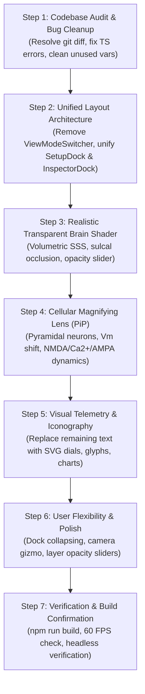

# UNIFIED NEURO-OBSERVATORY DIRECTIVE
## Autonomous Agent Specification: Complete Architectural Unification, 3D Transparent Tissue, Cellular Magnifying Lens, Iconography, and UI/UX Overhaul

---

## 1. Executive Directive & Mission Scope

### 1.1 Objective
This specification is a comprehensive blueprint for an autonomous coding agent to upgrade the **NeuroFlow tDCS Visualizer**. 

Your mandate comprises five core pillars:
1. **Unify the View Architecture:** Completely remove the segmented mode toggle (`ViewModeSwitcher`: Researcher / Clinical / Patient). Synthesize all biophysical modeling, clinical evidence, quantitative EEG data, cellular mechanisms, and patient sensation previews into a **single, unified, high-density yet glanceable clinical neuro-observatory** accessible to everyone.
2. **Review & Fix All Bugs:** Audit the codebase for uncommitted conflicts, hydration/rendering bugs, TypeScript type mismatches, WebGL memory leaks, unused imports, and bundle chunking warnings.
3. **Realistic 3D Filled Yet Transparent Brain Tissue:** Upgrade the Three.js brain mesh and custom GLSL shaders to render a **realistic, volumetric, filled yet semi-translucent living cortical tissue** with anatomical depth, sulcal crevices, gyral crowns, and subsurface scattering (SSS) that reveals internal current streamlines and deep subcortical structures. Provide a user-controlled tissue transparency/opacity slider.
4. **Show tDCS in Action (Macro-to-Micro Neuronal Magnifying Lens):** Create an interactive **Microscope Magnifying Lens (PiP / Inset Viewport)** focused on the active cortical stimulation patch. Show the biological mechanism of tDCS in real time: perpendicular pyramidal neurons, sub-threshold membrane polarization shift ($\Delta V_m = \lambda \cdot E$), action potential threshold tuning, $\text{Mg}^{2+}$ unblocking, $\text{Ca}^{2+}$ influx, and AMPA receptor trafficking.
5. **Show Instead of Tell (Iconography & Physical Animation):** Replace dense text paragraphs, symptom bullet lists, and raw numbers with standardized visual icons, interactive diagrams, and dials. Eliminate senseless sci-fi animations (arbitrary particle jitter) and retain only physics-grounded motion (DC current drift velocity, ionic diffusion, dipole gradients).
6. **Maximize User Flexibility:** Provide collapsible docks, layer opacity sliders, camera orientation snap-views, simulation speed controls, and interactive inspection targets.

---

## 2. Codebase Audit & Bug Fix Directives

Before implementing new features, execute the following audit and remediation steps:

### 2.1 Git State & File Cleanup
- **Review Working Tree:** Inspect unstaged changes across `src/App.tsx`, `src/components/`, and `src/components/visuals/`.
- **Remove Obsolete Mode Files:** Safely deprecate or integrate `src/components/ViewModeSwitcher.tsx` and remove mode-dependent conditionals that hide data.
- **Unused Declarations:** Clean up any TS6133 unused variable/import warnings across newly added visual components.
- **Verification Gate:** Run `npm run build` (`tsc && vite build`) and confirm 0 errors.

### 2.2 WebGL & Three.js Memory Leak Prevention
- Ensure all Three.js geometries, materials, shader programs, and render targets are cleanly disposed on component unmount (`geometry.dispose()`, `material.dispose()`).
- Verify that animation loops using `requestAnimationFrame` cancel their handles when modals or viewports unmount.
- Maintain a stable 60 FPS render loop by avoiding object allocations (e.g. `new THREE.Vector3()`) inside the per-frame `useFrame` or render loops.

---

## 3. Architecture Unification: Eliminating the Mode Toggle

### 3.1 The Problem with Mode Toggles
The previous implementation introduced a 3-way toggle (`Clinical`, `Research`, `Patient`) that locked away valuable biophysics (Miranda 2006 FEA, tissue conductivities, EEG spectra) from clinicians, and hid patient tolerability maps from researchers. 

### 3.2 The Unified Layout Blueprint
Eliminate `viewMode` from application state and props. Replace it with a single, universally accessible hierarchy:

```
+-----------------------------------------------------------------------------------------------------------------------+
| TOP BAR: [Logo & Title] | [Clinical Preset Ribbon (2D Glyphs)] | [Active Circuit Wire] | [Layer Depth Stack] | [Actions] |
+---------------------------------+---------------------------------------------------+---------------------------------+
| LEFT DOCK (300px - Collapsible) | CENTER 3D STAGE & CELLULAR MAGNIFIER              | RIGHT DOCK (380px - Collapsible)|
|                                 |                                                   |                                 |
| 1. Scalp Topomap (10-20 Compass)| • 3D Volumetric Semi-Transparent Brain Tissue     | UNIFIED 4-TAB INSPECTOR:        |
|    - Clickable Anode/Cathode    | • Scalp Electrodes & Current Drift Vectors        |                                 |
|                                 | • Floating Cellular Magnifying Lens (PiP HUD)     | [⚡ Biophysics] [🌊 EEG]        |
| 2. Dosimetry Controls           |   - Cortical Pyramidal Neurons in Action          | [🔬 Cellular]   [📋 Outcomes]   |
|    - Current Intensity Ammeter  |   - Subthreshold Vm Shift & Spike Rate            |                                 |
|    - Session Ramp Chronometer   | • E-Field Thermal Spectrum Milestone Bar          | TAB 1: BIOPHYSICS & DOSIMETRY   |
|    - Electrode Pad Footprint    | • Viewport Orientation Gizmo & Snap Views         | • Bikson Safety Arc Gauge       |
|                                 | • Tissue Translucency & Layer Sliders             | • Current Shunt Waterfall       |
| 3. Quick Safety Indicator       |                                                   | • Tissue Conductivity Stratum   |
|    - Bikson Multiplier Pip      |                                                   | • Charge Dose Reservoir         |
|                                 |                                                   |                                 |
|                                 |                                                   | TAB 2: QUANTITATIVE EEG         |
|                                 |                                                   | • 6-Band FFT Spectral Bar Chart |
|                                 |                                                   | • Band Symptom Deficit/Excess   |
|                                 |                                                   | • Neuro-Arousal Compass         |
|                                 |                                                   |                                 |
|                                 |                                                   | TAB 3: CELLULAR & SYNAPTIC      |
|                                 |                                                   | • Action Potential Bell Curve   |
|                                 |                                                   | • Molecular Synaptic Cleft      |
|                                 |                                                   | • GABA / Glutamate Balance      |
|                                 |                                                   | • Neuroplasticity Decay Curve   |
|                                 |                                                   |                                 |
|                                 |                                                   | TAB 4: CLINICAL & HUMAN OUTCOMES|
|                                 |                                                   | • Cognitive Impact Radar        |
|                                 |                                                   | • Somatosensory Sensation Map   |
|                                 |                                                   | • Sensation Matrix Glyphs       |
|                                 |                                                   | • Clinical Evidence Timeline    |
+---------------------------------+---------------------------------------------------+---------------------------------+
```

### 3.3 Implementation Details
1. In `src/App.tsx`:
   - Remove `const [viewMode, setViewMode] = useState<ViewMode>('clinical')`.
   - Remove `<ViewModeSwitcher />` from the header.
   - Set all child components (`SetupDock`, `InspectorDock`, `BrainViewport3D`, `SafetyBeacon`) to render their complete feature sets without mode filtering.
2. In `src/components/SetupDock.tsx`:
   - Display the clinical preset cards, 10-20 topomap compass, ammeter, and session ramp chronometer seamlessly.
3. In `src/components/InspectorDock.tsx`:
   - Standardize into four unified tabs:
     - **Tab 1 (`biophysics`):** Safety Gauge, Shunt Waterfall, Tissue Conductivity Stratum, Charge Dose Reservoir.
     - **Tab 2 (`eeg`):** 6-Band FFT Bar Chart, Band Symptom Matrix, Neuro-Arousal Compass.
     - **Tab 3 (`cellular`):** Firing Probability Bell Curve, Molecular Synaptic Cleft, Neurochemical Seesaw, Intracellular Signaling Cascade, Neuroplasticity Decay Curve.
     - **Tab 4 (`outcomes`):** Cognitive Impact Radar, Somatosensory Sensation Map, Sensation Glyphs, Clinical Evidence Timeline.

---

## 4. Realistic 3D Filled Yet Transparent Brain Tissue

### 4.1 Biophysical and Visual Rationale
In real clinical tDCS, electrical current does not skim only across the surface of the brain; it penetrates deep through the cortical grey matter, into the white matter tracts, and exits through the opposite montage pole. 
When the brain mesh is rendered as a solid, opaque surface, users cannot perceive:
1. Current streamlines coursing through the interior volume.
2. Deep subcortical field gradients (e.g. thalamic or striatal current density).
3. The spatial relationship between surface electrodes and underlying cortical structures.

### 4.2 Volumetric Living Tissue Shader Architecture
Update `CorticalHeatmapShader` in `src/components/BrainViewport3D.tsx` to support **dynamic semi-transparency with volumetric depth and subsurface scattering**:

```glsl
// Uniforms to add:
uniform float uTissueOpacity;      // Range: 0.15 (glass/hologram) to 0.85 (living translucent tissue)
uniform float uSubsurfaceGlow;     // Range: 0.0 to 1.0 (internal scatter intensity)

// In Fragment Shader:
// 1. Dual-Pass or Fresnel Alpha Calculation
float nDotV = max(dot(N, V), 0.0);
float fresnelRim = pow(1.0 - nDotV, 2.5);

// 2. Anatomical Depth & Crevice Occlusion
// Deep sulcal crevices retain higher optical density (higher alpha)
// Thin gyral crowns allow light to transmit through (subsurface translucency)
float baseAlpha = mix(uTissueOpacity * 0.85, uTissueOpacity, smoothstep(0.1, 0.6, c));
float finalAlpha = clamp(baseAlpha + fresnelRim * 0.35, 0.15, 0.95);

// 3. Volumetric Core Scattering Glow
// Emulate soft internal reddish-pink scatter from deep vascularization
vec3 internalScatter = vec3(0.85, 0.22, 0.20) * (1.0 - nDotV) * 0.25;
color += internalScatter * uSubsurfaceGlow;

// Final Color & Alpha
gl_FragColor = vec4(color, finalAlpha);
```

### 4.3 Material & Render State Configuration
In `BrainViewport3D.tsx`:
- Configure the brain mesh material with:
  ```typescript
  transparent: true,
  depthWrite: true,       // Ensures sulcal depth and occlusions sort cleanly
  depthTest: true,
  blending: THREE.NormalBlending,
  side: THREE.DoubleSide  // Allows viewing through the translucent opposite hemisphere
  ```
- Add a **Tissue Translucency Slider** to the floating 3D stage HUD (e.g., next to the Layer Stack) allowing users to adjust tissue opacity between 20% (holographic/internal inspection) and 90% (anatomical specimen).

---

## 5. Show tDCS in Action: The Neuronal Magnifying Lens (Microscope PiP)

### 5.1 Concept & Human Intuition
tDCS does not trigger action potentials directly (unlike TMS or ECT). Instead, it applies a sub-threshold electric field ($0.2$ to $1.0\text{ V/m}$) that shifts the neuronal resting membrane potential by merely $\approx 0.5$ to $1.5\text{ mV}$. This subtle bias either increases or decreases the probability of spontaneous action potential firing and modulates synaptic plasticity (LTP/LTD).

To make this immediately intuitive to any viewer, build the **Neuronal Magnifying Lens (Microscope PiP)**.

### 5.2 Component Blueprint: `src/components/visuals/NeuronalMagnifyingLens.tsx`
This component renders as a picture-in-picture floating viewport or toggleable magnifying glass over the active cortical stimulation site.

```
+-------------------------------------------------------------------------+
| 🔬 CELLULAR MICROSCOPE: Left DLPFC (Under F3 Anode)      [▲ Zoom] [✕]   |
| Scale: 50 µm | Cortical Layers I–III Pyramidal Column                   |
+-------------------------------------------------------------------------+
|   [Surface Pia Mater]                                                   |
|          │ E-Field Vector ↓ (Anodal Inward Flow)                        |
|          ▼                                                              |
|       ╭─────╮     Apical Dendrite                                       |
|       │  ▲  │     (Depolarized: +1.2 mV)                                |
|       │ / \ │                                                           |
|       │/   \│                                                           |
|       ╰──┬──╯                                                           |
|          │                                                              |
|       ╭─────╮     Pyramidal Soma                                        |
|      (  ⚡   )    Resting Vm: -69.2 mV → -68.4 mV (ΔVm +0.8 mV)         |
|       ╰──┬──╯     Firing Threshold: -55.0 mV (PROBABILITY: +42% ▲)      |
|          │                                                              |
|          ▼ Axon Hillock (High-frequency action potentials firing)       |
|    ───► ───► ───►  [ • • • • • ] (Action potential spike train)         |
|                                                                         |
|   SYNAPTIC TERMINAL (Micro-Inset):                                      |
|   • Glutamate Vesicles: Active fusion & release                         |
|   • NMDA Receptor: Mg²⁺ ion expelled (unblocked)                        |
|   • Post-Synaptic Spine: Ca²⁺ influx cascade → AMPA insertion (LTP)     |
+-------------------------------------------------------------------------+
| [Target Selector: 🔴 Anode Target (L-DLPFC) | 🔵 Cathode Target (Fp2)]  |
+-------------------------------------------------------------------------+
```

### 5.3 Dynamic Behavior Driven by Biophysics Engine
The Magnifying Lens must be directly hooked up to `telemetry` from `biophysicsEngine.ts`:
- **When Anode is targeted:**
  - Electric field points inward toward the cortex ($E_n > 0$).
  - Soma depolarizes ($\Delta V_m = +0.8\text{ mV}$, glowing warm coral).
  - Spike rate accelerates: animated sodium action potential pulses travel down the axon at 2× speed.
  - Synaptic cleft shows vesicle release, $\text{Mg}^{2+}$ expulsion, $\text{Ca}^{2+}$ green ionic dots flooding the dendritic spine, and new AMPA receptors inserting into the post-synaptic density.
- **When Cathode is targeted:**
  - Electric field points outward ($E_n < 0$).
  - Soma hyperpolarizes ($\Delta V_m = -0.8\text{ mV}$, glowing electric cyan).
  - Spike rate decreases: axon pulses slow to a trickle or cease.
  - Synaptic cleft shows reduced vesicle release and AMPA receptor internalization (LTD).
- **Current Intensity Modulation:**
  - As `currentMa` increases from 1.0 to 2.0 to 4.0 mA, the particle flux, $\Delta V_m$ counter, and action potential firing frequency scale proportionally.

---

## 6. Show Instead of Tell: Comprehensive Iconography & UI/UX Transformation

### 6.1 Eliminate Senseless Animations
- **Remove:**
  - Random floating particle noise that drifts in arbitrary directions unrelated to physics.
  - Arbitrary flashing/pulsing lights that look like decorative disco effects.
- **Enforce Physics-Grounded Motion:**
  - Current drift velocity along streamlines ($v_d = \mu E$).
  - Ramped current transitions: When the user moves the `currentMa` slider, the current ramps smoothly over 300 ms rather than jumping.
  - Waveform propagation: EEG waves oscillate at exact physiological frequencies (Delta 2 Hz, Theta 6 Hz, Alpha 10 Hz, Beta 20 Hz, Gamma 40 Hz).

### 6.2 Iconography Dictionary: Replace Text with Visual Glyphs
Standardize visual iconography across all panels:

| Clinical / Scientific Concept | Current Representation | New Standardized Icon / Visual Glyph |
| :--- | :--- | :--- |
| **Anode (+) Excitatory** | Text "Anode" / Red button | Radiant Coral Disc with `+` polarity and inward electrical arrows |
| **Cathode (–) Inhibitory** | Text "Cathode" / Blue button | Electric Cyan Disc with `–` polarity and outward electrical arrows |
| **Scalp Shunt Loss** | Text "62.4% shunted" | Waterfall flow diversion glyph or broken circuit shunt icon |
| **Bikson Safety Factor** | Table numbers "0.0800 mA/cm²" | Aviation dial gauge with Emerald/Amber/Rose safety zones |
| **Charge Dose** | Text "2.40 C" | Fluid battery cylinder reservoir with dynamic meniscus |
| **Scalp Tingling** | Text score "7.2 / 10" | 5-bar sensory antenna glyph with tactile vibration waves |
| **Metallic Taste** | Text paragraph | Lingual nerve tongue glyph with metallic spark icon |
| **Retinal Phosphenes** | Text warning bullet | Eye silhouette with peripheral optic lightning flare glyph |
| **Skin Erythema** | Text "Mild redness" | Dermal cross-section swatch with capillary vasodilation glow |
| **Depression / Mood** | Text "Depression (L-DLPFC)" | ☀️ Golden sunrise glyph over frontal lobe silhouette |
| **Attention / ADHD** | Text "Focus & Attention" | 🎯 Concentric target crosshair over prefrontal cortex |
| **Motor Rehab / Stroke** | Text "Motor Cortex (C3)" | ⚡ Dynamic neuromuscular spark over central gyrus |
| **Pain Relief / Fibromyalgia**| Text "Chronic Pain" | 🛡️ Soothing analgesic shield glyph |
| **Language / Broca** | Text "Broca's Area" | 💬 Phonetic waveform speech bubble glyph |

---

## 7. User Flexibility & Customization Controls

To ensure clinicians, researchers, and students can tailor the interface to their immediate needs, provide the following controls:

1. **Collapsible Docks:**
   - Both Left Setup Dock and Right Inspector Dock can be independently collapsed to maximize 3D brain viewing area.
   - Smooth slide-out transitions with clear collapse/expand icon buttons (`PanelLeftClose`, `PanelRightClose`).
2. **Camera Orientation Snap-Views:**
   - A 3D Viewport Gizmo with instant one-click camera snap positions:
     - `👤 Anterior (Face & Frontal Lobes)`
     - `🧠 Left Lateral (DLPFC / Motor / Broca)`
     - `🧠 Right Lateral (Creativity / Spatial)`
     - `⬆️ Vertex (Top-down 10-20 symmetry)`
     - `👁️ Occipital (Visual Cortex)`
     - `🔄 Free Orbit / Reset`
3. **Layer Opacity & Visibility Stack:**
   - Expandable layer drawer with independent toggle checkboxes and opacity sliders:
     - Skin / Face Contour (0% to 100%)
     - Scalp 10-20 Grid & Electrodes
     - Skull Barrier & Shunt Ring
     - Cortical Living Tissue (Translucency slider: 15% to 90%)
     - E-Field Heatmap Overlay
     - 3D Current Streamlines
     - Neural Point Cloud
     - Brodmann Cytoarchitectural Labels
4. **Interactive Simulation Speed:**
   - Simulation playback bar with controls: `⏸ Pause`, `▶ Play (1×)`, `⏩ Fast Forward (2×)`, and `↺ Reset Session`.

---

## 8. Step-by-Step Implementation Roadmap for the Agent

Follow these sequential steps to implement the complete overhaul:



### Detailed Phase Tasks:

#### Phase 1: Audit & Bug Cleanup
- Inspect current modified files (`src/App.tsx`, `src/components/`, etc.).
- Ensure no orphaned components or duplicate files cause bundling errors.
- Verify `npm run build` succeeds cleanly.

#### Phase 2: Unify Interface & Remove ViewMode
- Remove `viewMode` state and `ViewModeSwitcher` from `src/App.tsx`.
- Refactor `src/components/SetupDock.tsx` and `src/components/InspectorDock.tsx` to display all clinical, biophysical, EEG, cellular, and outcome modules without mode filtering.
- Group the Inspector Dock into the 4 unified tabs: `Biophysics`, `EEG`, `Cellular`, and `Outcomes`.

#### Phase 3: Volumetric Semi-Transparent Brain Tissue
- Update `CorticalHeatmapShader` in `src/components/BrainViewport3D.tsx` to support `uTissueOpacity` and `uSubsurfaceGlow`.
- Implement Fresnel translucency, sulcal crevice depth preservation, and two-pass/transparent mesh blending.
- Add an interactive tissue opacity slider to the viewport stage controls.

#### Phase 4: Build the Neuronal Magnifying Lens
- Create `src/components/visuals/NeuronalMagnifyingLens.tsx`.
- Connect it directly to `telemetry` (`fieldStrengthVm`, `membraneShiftMv`, `currentMa`, `anodeId`, `cathodeId`).
- Render animated pyramidal neurons, real-time $\Delta V_m$ threshold shift, action potential firing trains, and the molecular synaptic cleft ($\text{Mg}^{2+}$ unblocking, $\text{Ca}^{2+}$ influx, AMPA trafficking).
- Integrate it into `BrainViewport3D.tsx` as a floating, draggable/collapsible PiP microscope window.

#### Phase 5: Iconography & Visual Upgrades
- Replace any remaining text progress bars with circular gauges or SVG spectrums.
- Embed the sensation glyphs, tissue conductivity stratum, and clinical evidence timeline into their respective unified tabs.
- Ensure all animations correspond to real physical phenomena (drift velocity, oscillation frequencies).

#### Phase 6: User Flexibility
- Verify that left and right docks can be collapsed with smooth animations.
- Ensure the 3D camera orientation gizmo snaps smoothly to standard clinical viewpoints.
- Provide clear visual indicators for active presets and electrode selections.

#### Phase 7: Verification & Testing
- Run `npm run build` to confirm 0 compilation errors.
- Test in browser (or via CDP) to ensure 60 FPS WebGL performance, responsive resizing, and seamless interaction across all tabs.

---

## 9. Definition of Done (Acceptance Criteria)

1. **Unified View:** Zero traces of the `ViewModeSwitcher` toggle (`Clinical / Research / Patient`). All users have immediate access to all biophysical, EEG, cellular, and outcome telemetry.
2. **Realistic Transparent Brain:** The 3D cortical tissue renders with biological realism, sulcal depth, and user-adjustable translucency that reveals internal current pathways.
3. **Cellular Magnifying Lens Active:** A working macro-to-micro microscope lens displays live pyramidal neurons, subthreshold $\Delta V_m$ membrane shifts, action potential spike rates, and synaptic plasticity mechanisms.
4. **Visual-First Interface:** All key metrics, safety parameters, and sensations are conveyed via icons, gauges, radar charts, and diagrams rather than dense text blocks.
5. **Clean Build:** `npm run build` completes with 0 errors and 0 warnings.
6. **Smooth Performance:** The 3D stage and animated visual telemetry run smoothly at 60 FPS.
